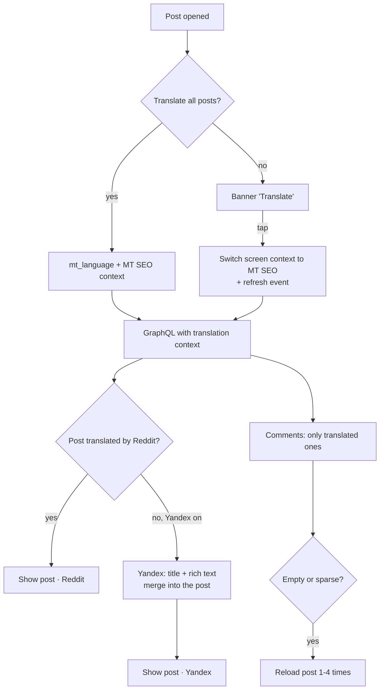
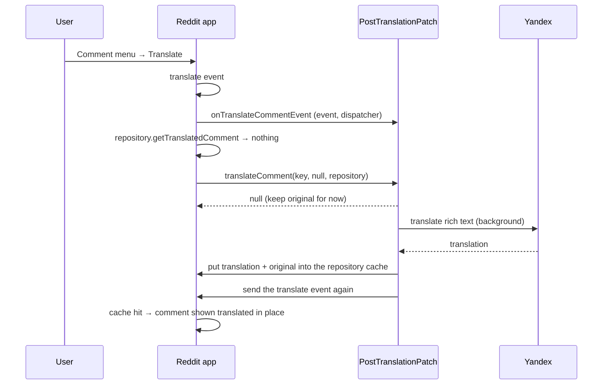

# Reddit: Translate posts

[Русская версия](README.ru.md)

The **Translate posts** patch translates Reddit posts and comments into the user's language inside the
official Reddit app. It uses the machine translation that Reddit itself serves and falls back to Yandex
when Reddit has no translation.

Tested on Reddit **2026.41.0**.

## Features

| Feature | Description |
|---|---|
| Translate all posts | Every post opens already translated: title, text and comments. |
| Translate on demand | With automatic translation off, every foreign post shows a "Translate" banner. "Translate" translates the post in place, without leaving the screen; comments stay in the original. |
| Show original | The banner switches a translated post back to the original. |
| Yandex fallback | Reddit has translations only for some posts and languages. When there is none, the title and the text of the post are translated with Yandex. |
| Translation source | The banner title shows who translated the post: "… · Reddit" or "… · Yandex". |
| Translate a comment | The comment menu gets a "Translate" action. The comment is translated with Yandex and shown in place, with the app's own "Show original". |
| Translation language | "App language" (default) or any language of the shared Morphe language list. |

## Settings

Morphe settings → **Translation**:

| Key | Default | Meaning |
|---|---|---|
| `morphe_translate_all_posts` | off | Open every post translated (MT SEO mode, see below). |
| `morphe_translation_language` | `DEFAULT` | Target language. `DEFAULT` is the app language, other values are ISO 639 codes. |
| `morphe_translation_yandex_fallback` | on | Use Yandex when Reddit has no translation. Text is sent to Yandex. |
| `morphe_translation_comment_menu` | on | "Translate" in the comment menu. Available only with the Yandex fallback on. |

## How it works

### Reddit's own translation: MT SEO mode

Reddit serves machine-translated pages for search engines: `reddit.com/r/…/comments/…?tl=de`. The app
supports these links. A link with `?tl=xx` opens the post detail screen with the `mt_language` argument.
The screen then uses an **MT SEO** post context and an MT SEO comments context, and the GraphQL requests
carry a translation context, so the server returns a translated post and translated comments.

The patch turns this mode on without such a link:

- **Translate all posts.** The patch supplies the target language when the screen reads `mt_language`
  and builds an MT SEO post context for posts opened from a feed. The app normally accepts MT SEO only for
  deep links (`Link.isMtSeoDeepLink()`), so the patch also replaces that check in the post and comments
  MT SEO checks.
- **Translate on demand.** The patch shows the translation banner for every foreign post. "Translate"
  switches the post context of the open screen to MT SEO and sends the app's own pull-to-refresh event, so
  the post reloads translated in place. Only the post is switched; the comments stay in the original. If
  the screen cannot be switched, the patch opens the `?tl=` link instead.

### What the server returns

- **Posts.** The server has translations only for some posts and languages. Older popular posts are
  usually translated; fresh posts often are not.
- **Comments.** The server translates comments on demand, and an MT SEO response contains **only the
  comments that are already translated**. Untranslated comments are not sent at all. The first load of a
  fresh post is therefore often empty or partial. The patch reloads the post: up to 4 times
  (1.5 / 3 / 5 / 8 s) when no comments came, once when fewer than a quarter came. Whether a reload is
  still needed is decided when it fires, from the last load, because comments often arrive in two loads in
  a row.

### Yandex fallback

- **Posts.** Posts are loaded by id in the GraphQL data source. When MT SEO was requested but a post
  came back untranslated, the patch translates the title and the rich text (or the HTML text) with Yandex
  on the request thread. It then merges the result with the app's own "merge translation" function, so the
  app sees an ordinary translated post. Media, previews and galleries are kept from the original post.
- **Comments.** Reddit's per-comment translation API returns nothing for many users. When the app asks
  its translations repository for a comment translation and gets nothing, the patch translates the
  comment with Yandex in the background. It puts the translation into the repository cache and the
  original into the "show original" map, then sends the comment's "Translate" event again. The app finds
  the translation in its cache and shows it in place.
- **Rich text.** Reddit renders post and comment bodies from rich text JSON (`rtjson`). `RichTextTranslator`
  extracts the text and link nodes as HTML fragments with inline styles, translates them in batches and
  writes the translations back. The document structure, links and formatting are kept.
- **Requests.** `YandexTranslator` uses the Yandex browser translation endpoint (`format=html`). It sends
  chunked batches of up to 10 texts and 1500 characters, and retries 429 and 5xx responses up to 3 times
  with backoff. The first failure shows a toast; later failures are only logged until a request succeeds
  again.

### Translation source in the banner

The post detail screen is a **pager**: together with the open post it also loads the posts next to it.
Any "last loaded post" state is therefore unreliable. The patch keeps the source per screen:

- When a post loads, the screen's `RedditPostDetailViewModel` is stored with a flag "translated by
  Yandex". Yandex translations are recognised by a hash of the translated title. The hashes are kept in
  preferences (LRU of 500), because the app caches translated posts between launches.
- The banner section of each screen gets that screen's post detail context. It is a Kotlin function
  reference, and its bound receiver is the same `RedditPostDetailViewModel`. While the banner is composed,
  the patch knows which screen the banner belongs to.

## Architecture

The patch follows the repository conventions: no reflection on obfuscated names, all app code found by
fingerprints, and app types used through stubs and interfaces.

```
patches/src/main/kotlin/app/morphe/patches/reddit/misc/translation/
  TranslatePostsPatch.kt     patch declaration: installTranslation(resolveTranslationAbi())
  Fingerprints.kt            fingerprints of the app code
  TranslationAbi.kt          resolver: finds and checks everything, modifies nothing
  TranslationInstallers.kt   installers: hooks, interfaces and bridges

extensions/reddit/src/main/java/app/morphe/extension/reddit/
  patches/PostTranslationPatch.java     logic, injection points, extension interfaces
  translation/YandexTranslator.java     Yandex client (Requester, retries)
  translation/RichTextTranslator.java   rich text JSON <-> HTML fragments
  settings/Settings.java, settings/preference/categories/TranslationPreferenceCategory.java

extensions/reddit/stub/                 compile-only stubs: Link, Comment, TranslatedLink, OriginalComment, ...
patches/src/main/resources/addresources/values{,-ru-rRU}/reddit/strings.xml
```

### Resolve, then install

`resolveTranslationAbi()` runs every fingerprint with `matchSingle()`, so each must match exactly once.
It reads the instructions and registers and returns typed structures: `ScreenContextAbi`, `BannerAbi`,
`PostLoadingAbi`, `RefreshAbi`, `CommentsAbi`, with `CallSite`s, field and method references. Nothing is
modified at this point. If a new Reddit version breaks an anchor, the patch fails before the first change
instead of leaving the app half patched.

`installTranslation(abi)` then applies the changes in groups: screen context, MT SEO checks, banner, post
loading, in-place translation, comments.

### Talking to obfuscated code

There are three mechanisms, and none uses reflection on obfuscated names:

1. **Injection points.** These are static `PostTranslationPatch` methods called from hooks at found
   instructions, for example `getMtLanguage`, `isMtSeoActive`, `onTranslateClicked`, `onPostLoaded`,
   `translateLoadedPosts`, `beforeRefresh`, `onCommentsLoaded`, `translateComment`,
   `isCommentTranslateVisible`, `getTranslationBannerTitle`, `setBannerScreen` / `clearBannerScreen`.
2. **Extension interfaces on app classes.** The patch adds an interface of the extension to an
   obfuscated app class and generates its methods inside that class, so private fields stay private:

   | Interface | App class (2026.41) | Methods |
   |---|---|---|
   | `RefreshHandler` | `PostDetailRefreshEventHandler` | `patch_getScreenPost`, `patch_switchToMtSeo` |
   | `EventDispatcher` | post detail event dispatcher | `patch_dispatchEvent`, `patch_getScreen` |
   | `TranslationsRepository` | `RedditTranslationsRepository` | `patch_putTranslatedComment`, `patch_putOriginalComment` |
   | `TranslationKey` | comment translation cache key | `patch_getCommentId` |
   | `TranslateCommentEvent` | comment "Translate" event | `patch_getCommentId` |
   | `CommentLinkInfo` | `CommentLink` | `patch_getPostId`, `patch_getNumComments` |

3. **Static bridges.** These are private stub methods of the extension that throw. The patch replaces
   their bodies (`cloneMutable`) with calls to obfuscated static methods and constructors:
   `mergeTranslation`, `newMtSeoPostContext`, `newTranslatedComment`, `invokeFunction`,
   `getScreenOfFunction`.

### Flows





## Limitations

- After "Show original" of a post in automatic mode, translating the post again translates the post,
  but its comments stay in the original until the app restarts.
- Comments that the server has not translated yet are missing in MT SEO mode until it translates them;
  the reloads only wait for them.
- Mixed sources: a post can be translated by Yandex while its comments are translated by Reddit. The
  banner shows the source of the post.
- The fingerprints were checked on 2026.41.0 only.

## Build and test

```bash
export ANDROID_HOME=<Android SDK>
./gradlew :patches:buildAndroid
java -jar morphe-desktop-<version>-all.jar patch -p patches/build/libs/patches-<version>.mpp -f \
  --keystore=<keystore> -o reddit-patched.apk <reddit-2026.41.0.apkm>
```

The build needs an SDK platform named `platforms/android-37`. Device checks:

- a post translated by Reddit and one translated by Yandex, with the source in the banner;
- "Translate" with automatic translation off, then "Show original";
- swiping the post pager;
- "Translate" and "Show original" in the comment menu;
- a fresh post whose comments come empty at first.
