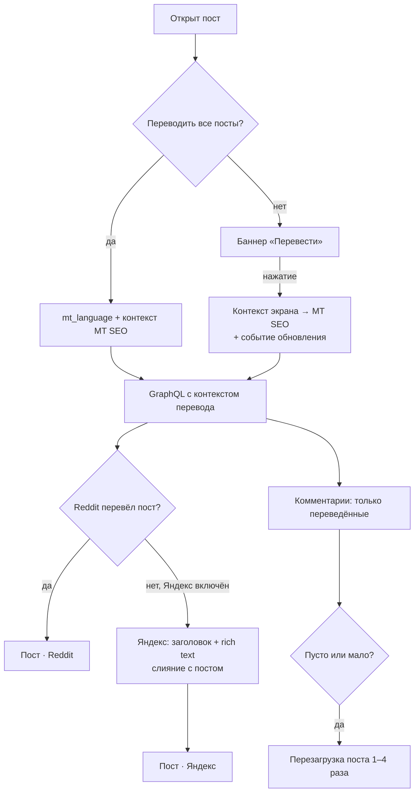
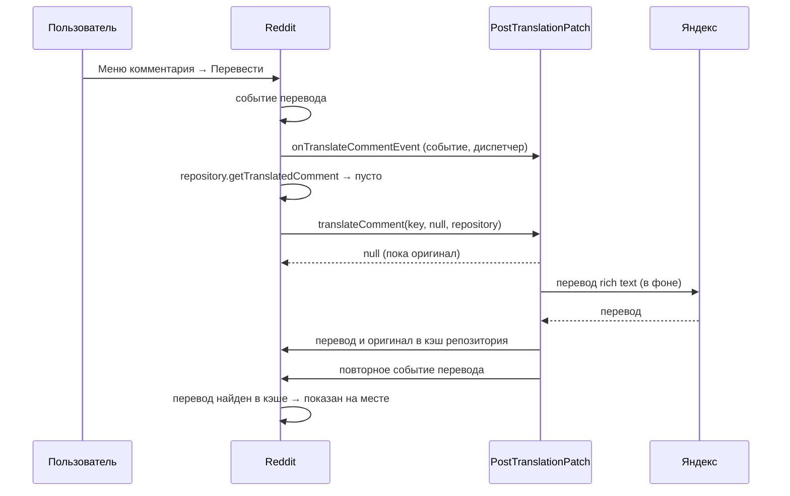

# Reddit: Translate posts

[English version](README.md)

Патч **Translate posts** переводит посты и комментарии Reddit на язык пользователя прямо в официальном
приложении Reddit. Он использует машинный перевод, который отдаёт сам Reddit, а если у Reddit перевода
нет, переводит через Яндекс.

Проверено на Reddit **2026.41.0**.

## Возможности

| Возможность | Описание |
|---|---|
| Переводить все посты | Каждый пост открывается уже переведённым: заголовок, текст и комментарии. |
| Перевод по запросу | Если автоперевод выключен, в каждом иностранном посте есть баннер «Перевести». Пост переводится на месте, без перехода на другой экран; комментарии остаются в оригинале. |
| Показать оригинал | Баннер возвращает переведённый пост к оригиналу. |
| Перевод через Яндекс | У Reddit есть переводы только для части постов и языков. Если перевода нет, заголовок и текст поста переводит Яндекс. |
| Источник перевода | В заголовке баннера указано, кто перевёл пост: «… · Reddit» или «… · Яндекс». |
| Перевод комментария | В меню комментария есть пункт «Перевести». Комментарий переводит Яндекс, перевод показывается на месте, со штатным «Показать оригинал». |
| Язык перевода | «Язык приложения» (по умолчанию) или любой язык из общего списка языков Morphe. |

## Настройки

Настройки Morphe → **Перевод**:

| Ключ | По умолчанию | Назначение |
|---|---|---|
| `morphe_translate_all_posts` | выкл. | Открывать все посты в переводе (режим MT SEO, см. ниже). |
| `morphe_translation_language` | `DEFAULT` | Язык перевода. `DEFAULT` — язык приложения, остальные значения — коды ISO 639. |
| `morphe_translation_yandex_fallback` | вкл. | Переводить через Яндекс, если у Reddit нет перевода. Текст отправляется в Яндекс. |
| `morphe_translation_comment_menu` | вкл. | Пункт «Перевести» в меню комментария. Доступен только при включённом переводе через Яндекс. |

## Принцип работы

### Собственный перевод Reddit: режим MT SEO

Для поисковиков Reddit отдаёт машинно переведённые страницы: `reddit.com/r/…/comments/…?tl=de`.
Приложение умеет открывать такие ссылки. Ссылка с `?tl=xx` открывает экран поста с аргументом
`mt_language`. Экран использует контекст поста **MT SEO** и контекст комментариев MT SEO, а в
GraphQL-запросы добавляется контекст перевода. В ответ сервер присылает переведённый пост и
переведённые комментарии.

Патч включает этот режим без такой ссылки:

- **Переводить все посты.** Когда экран читает `mt_language`, патч подставляет язык перевода, а для
  постов из ленты строит контекст MT SEO. Обычно приложение принимает MT SEO только для диплинков
  (`Link.isMtSeoDeepLink()`), поэтому патч заменяет и эту проверку в проверках MT SEO поста и
  комментариев.
- **Перевод по запросу.** Патч показывает баннер перевода у каждого иностранного поста. «Перевести»
  переключает контекст открытого экрана на MT SEO и отправляет штатное событие обновления («потянуть
  вниз»), и пост перезагружается в переводе на месте. Переключается только пост, комментарии остаются
  в оригинале. Если экран переключить не удалось, патч открывает ссылку с `?tl=`.

### Что возвращает сервер

- **Посты.** У сервера есть переводы только для части постов и языков. Старые популярные посты обычно
  переведены, свежие часто нет.
- **Комментарии.** Сервер переводит комментарии по запросу, и в ответ MT SEO попадают **только уже
  переведённые комментарии**. Непереведённые не присылаются вовсе. Поэтому первая загрузка свежего поста
  часто пустая или неполная, и патч перезагружает пост:
  - до 4 раз (через 1,5 / 3 / 5 / 8 с), если комментариев нет совсем;
  - один раз, если пришло меньше четверти.

  Нужна ли перезагрузка, решается в момент её срабатывания, по последней загрузке: комментарии часто
  приходят двумя порциями подряд.

### Перевод через Яндекс

- **Посты.** Посты по id загружаются в источнике данных GraphQL. Если перевод MT SEO был запрошен, но
  пост пришёл непереведённым, патч прямо в потоке запроса переводит Яндексом заголовок и rich text (или
  HTML-текст). Затем он объединяет результат с постом штатной функцией приложения «слить перевод», так что
  приложение видит обычный переведённый пост. Медиа, превью и галереи берутся из оригинального поста.
- **Комментарии.** API перевода отдельного комментария Reddit у многих пользователей ничего не
  возвращает. Когда приложение запрашивает у репозитория переводов перевод комментария и получает пустой
  ответ, патч в фоне переводит комментарий Яндексом. Он кладёт перевод в кэш репозитория, а оригинал в
  карту «показать оригинал», и повторно отправляет событие «Перевести» этого комментария. Приложение
  находит перевод в кэше и показывает его на месте.
- **Rich text.** Тексты постов и комментариев Reddit отображает из JSON rich text (`rtjson`).
  `RichTextTranslator` извлекает текстовые узлы и ссылки как HTML-фрагменты со стилями, переводит их
  пакетами и записывает переводы обратно. Структура документа, ссылки и форматирование сохраняются.
- **Запросы.** `YandexTranslator` обращается к эндпоинту перевода Яндекс Браузера (`format=html`). Он
  отправляет пакеты до 10 текстов и 1500 символов, а ответы 429 и 5xx повторяет до 3 раз с паузой. Первая
  ошибка показывается уведомлением; следующие только пишутся в лог, пока запрос снова не пройдёт.

### Источник перевода в баннере

Экран поста — это **пейджер**: вместе с открытым постом он загружает и соседние. Поэтому любое
состояние «последнего загруженного поста» ненадёжно, и патч хранит источник отдельно для каждого экрана:

- При загрузке поста `RedditPostDetailViewModel` его экрана запоминается с флагом «переведено Яндексом».
  Переводы Яндекса узнаются по хешу переведённого заголовка. Хеши хранятся в настройках (LRU на 500
  записей), потому что приложение кэширует переведённые посты между запусками.
- Разделу баннера каждого экрана передаётся контекст поста этого экрана. Это ссылка на функцию Kotlin, и
  её привязанный получатель — та же `RedditPostDetailViewModel`. Пока баннер рисуется, патч знает, какому
  экрану он принадлежит.

## Архитектура

Патч следует соглашениям репозитория: никакой рефлексии по обфусцированным именам, весь код приложения
находится fingerprint'ами, а типы приложения используются через заглушки и интерфейсы.

```
patches/src/main/kotlin/app/morphe/patches/reddit/misc/translation/
  TranslatePostsPatch.kt     объявление патча: installTranslation(resolveTranslationAbi())
  Fingerprints.kt            fingerprint'ы кода приложения
  TranslationAbi.kt          поиск: всё находит и проверяет, ничего не меняет
  TranslationInstallers.kt   установка: хуки, интерфейсы и мосты

extensions/reddit/src/main/java/app/morphe/extension/reddit/
  patches/PostTranslationPatch.java     логика, точки внедрения, интерфейсы extension
  translation/YandexTranslator.java     клиент Яндекса (Requester, повторы)
  translation/RichTextTranslator.java   JSON rich text <-> HTML-фрагменты
  settings/Settings.java, settings/preference/categories/TranslationPreferenceCategory.java

extensions/reddit/stub/                 заглушки только для компиляции: Link, Comment, TranslatedLink, OriginalComment, ...
patches/src/main/resources/addresources/values{,-ru-rRU}/reddit/strings.xml
```

### Сначала поиск, потом установка

`resolveTranslationAbi()` запускает каждый fingerprint через `matchSingle()`, так что каждый должен
совпасть ровно один раз. Функция читает инструкции и регистры и возвращает типизированные структуры:
`ScreenContextAbi`, `BannerAbi`, `PostLoadingAbi`, `RefreshAbi`, `CommentsAbi`, с `CallSite`, ссылками на
поля и методы. На этом этапе ничего не меняется. Если в новой версии Reddit сломается какая-то опора,
патч остановится до первой правки, а не оставит приложение пропатченным наполовину.

Затем `installTranslation(abi)` вносит изменения группами: контекст экрана, проверки MT SEO, баннер,
загрузка постов, перевод на месте, комментарии.

### Связь с обфусцированным кодом

Механизмов три, и ни один не использует рефлексию по обфусцированным именам:

1. **Точки внедрения.** Это статические методы `PostTranslationPatch`, которые вызываются из хуков в
   найденных инструкциях, например `getMtLanguage`, `isMtSeoActive`, `onTranslateClicked`,
   `onPostLoaded`, `translateLoadedPosts`, `beforeRefresh`, `onCommentsLoaded`, `translateComment`,
   `isCommentTranslateVisible`, `getTranslationBannerTitle`, `setBannerScreen` / `clearBannerScreen`.
2. **Интерфейсы extension на классах приложения.** Патч добавляет интерфейс extension к обфусцированному
   классу приложения и генерирует его методы внутри этого класса, поэтому приватные поля остаются
   приватными:

   | Интерфейс | Класс приложения (2026.41) | Методы |
   |---|---|---|
   | `RefreshHandler` | `PostDetailRefreshEventHandler` | `patch_getScreenPost`, `patch_switchToMtSeo` |
   | `EventDispatcher` | диспетчер событий экрана поста | `patch_dispatchEvent`, `patch_getScreen` |
   | `TranslationsRepository` | `RedditTranslationsRepository` | `patch_putTranslatedComment`, `patch_putOriginalComment` |
   | `TranslationKey` | ключ кэша перевода комментария | `patch_getCommentId` |
   | `TranslateCommentEvent` | событие «Перевести» комментария | `patch_getCommentId` |
   | `CommentLinkInfo` | `CommentLink` | `patch_getPostId`, `patch_getNumComments` |

3. **Статические мосты.** Это приватные методы-заглушки extension, которые бросают исключение. Патч
   заменяет их тела (`cloneMutable`) вызовами обфусцированных статических методов и конструкторов:
   `mergeTranslation`, `newMtSeoPostContext`, `newTranslatedComment`, `invokeFunction`,
   `getScreenOfFunction`.

### Схемы





## Ограничения

- Если в автоматическом режиме нажать «Показать оригинал», а потом снова перевести пост, переведётся
  только сам пост. Его комментарии останутся в оригинале до перезапуска приложения.
- Комментариев, которые сервер ещё не перевёл, в режиме MT SEO нет, пока он их не переведёт.
  Перезагрузки только ждут их появления.
- Источники могут смешиваться: пост переведён Яндексом, а комментарии Reddit. Баннер показывает источник
  поста.
- Fingerprint'ы проверены только на 2026.41.0.

## Сборка и проверка

```bash
export ANDROID_HOME=<Android SDK>
./gradlew :patches:buildAndroid
java -jar morphe-desktop-<version>-all.jar patch -p patches/build/libs/patches-<version>.mpp -f \
  --keystore=<keystore> -o reddit-patched.apk <reddit-2026.41.0.apkm>
```

Для сборки нужна платформа SDK с именем `platforms/android-37`. На устройстве стоит проверить:

- пост, переведённый Reddit, и пост, переведённый Яндексом, с источником в баннере;
- «Перевести» при выключенном автопереводе, затем «Показать оригинал»;
- перелистывание пейджера постов;
- «Перевести» и «Показать оригинал» в меню комментария;
- свежий пост, у которого сначала нет комментариев.
